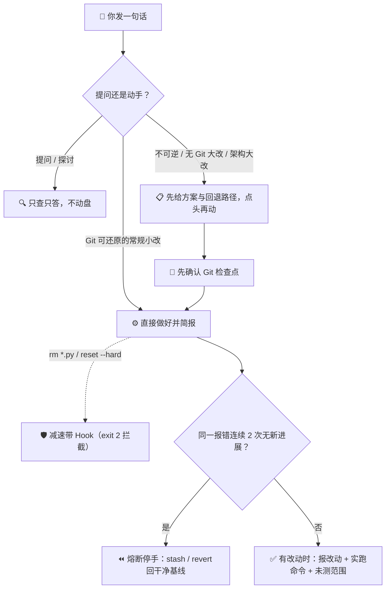

<div align="center">

**🇨🇳 简体中文** · **[🇺🇸 English Edition (Read in English →)](../en/README.md)** · **[🏠 返回总览](../README.md)**

> 🌍 **Non-Chinese Readers:** Complete English version (guide, templates, hooks & postmortems) is at **[`en/README.md`](../en/README.md)**

# 🛟 AI 协同生存指南（初学者安全协作版）

**AI 说“全部通过”的时候，才是最该查的时候。**

一套极简规则插件（**约 2.0 KB / 12 行，不拖慢 AI**）+ 独立自包含 **[中文 Agent Skill](skills/ai-survival-guard/SKILL.md)** + 五堂给初学者看的 **人机对齐与防翻车实战课**。

[](https://github.com/reiwhale/ai-collaboration-survival-guide/actions/workflows/hook-tests.yml)
[](../LICENSE)
[](../LICENSE-DOCS)


**[🍼 一键挂载提示词](#一键挂载与卸载提示词)** · **[📖 实战五课](#人机协同实战五课给人看)** · **[🛡️ 硬护栏配置](guardrails/hooks/README.md)** · **[🧪 模型适配表](templates/MODEL_FIT.md)**

</div>

---

## 为什么这套方案不会让你的 AI 变笨？

> **ETH Zurich（2026）**（[arXiv:2602.11988](https://arxiv.org/abs/2602.11988)）实证冗余的 `AGENTS.md` 平均增加 **20% 以上**推理成本；**IFScale**（[arXiv:2507.11538](https://arxiv.org/abs/2507.11538)）同样证实：硬塞大段流程会触发模型遵循率衰减或规则瘫痪，让小模型直接变蠢。

因此本仓库做**严格分离**：
- **给 AI 看的**：只有 `约 2.0 KB` 的 [`AGENTS.lite.md`](templates/AGENTS.lite.md)（仅留 **问改分离与高风险确认 / Git 保底与 2 次熔断 / 只报实测不瞎编 / 源码优先与按需探环境** 4 条零磨擦刹车线，日常明确小改直接干活不啰嗦）。
- **给你看的**：`handbook/` 五堂实战课——教你**怎么提需求、怎么贴报错、怎么防被假绿灯糊弄**，**切勿整包塞进 AI 提示词**！



<sub>📌 术语白话：`CWD` = 当前项目根目录；`PreToolUse Hook` = AI 执行终端命令前的自动安检脚本（命中返回 `exit 2` 硬拦，仅作**防手滑减速带**，真实兜底靠 Git + 宿主审批）。</sub>

---

## 一键挂载与卸载提示词

> 懒得手工配？先将本仓库克隆到任意本地路径，把下面提示词中的 `<指南仓库路径>` 替换为你的实际路径后发给 AI 助手（如果 AI 当前工作区就是本仓库，则只需指定目标项目路径）：

**① 一键挂载到当前工作区（CWD）：**
```text
帮我把 `<指南仓库路径>` 里的「AI 协同生存指南」挂载进当前项目（CWD）：
1. 读取 `<指南仓库路径>/cn/templates/AGENTS.lite.md` 的完整内容（约 2.0 KB），用 `<!-- BEGIN AI-SURVIVAL-GUARD -->` 和 `<!-- END AI-SURVIVAL-GUARD -->` 注释包裹后，写入或追加到当前项目根目录的 `AGENTS.md`（若使用 Claude Code 则同步写入 `CLAUDE.md`；不要只留外部路径指针，避免弱模型不顺着读），严禁把 `cn/handbook/` 塞进常驻规则。
2. 按需复制 `<指南仓库路径>/cn/templates/LESSONS.template.md` 为 `docs/lessons.md`（如已存在则保留不动），可选复制 `<指南仓库路径>/cn/scripts/probe_env.py` 到当前项目 `scripts/` 目录，并确认 `.gitignore` 已忽略 `.agent-env.local.txt` 与 `_trash_box/`。
```

**② 一键安全卸载：**
```text
请从当前项目（CWD）卸载「AI 协同生存指南」：
1. 精准删除根目录 `AGENTS.md` / `CLAUDE.md` 中 `<!-- BEGIN AI-SURVIVAL-GUARD -->` 到 `<!-- END AI-SURVIVAL-GUARD -->` 之间的内容（若删完后文件为空则直接删掉该空文件，切勿误伤项目原有规则）。
2. 移除可选的 `scripts/probe_env.py`（若 `scripts/` 变空一并删除）以及本地生成的 `.agent-env.local.txt`；如曾安装过 `.claude/hooks/block-dangerous.*` 也请询问我是否一并移除。
3. 绝对保留我自己积累的 `docs/lessons.md` 与项目原有 `.gitignore` 条目不动。
```

### 宿主工具适配矩阵

| 工具 / IDE | 规则模板（`AGENTS.lite.md` / `SKILL.md`） | 终端减速带 Hook（`guardrails/hooks/`） | 推荐组合 |
|---|---|---|---|
| **Claude Code** | ✅ 写入 `CLAUDE.md` / `AGENTS.md` 或加载 [`SKILL.md`](skills/ai-survival-guard/SKILL.md) | ✅ 已提供零坑样例（[`examples/`](guardrails/hooks/examples/)，安装见 [Hook 指南](guardrails/hooks/README.md)） | Lite 规则 + Hook 减速带 + Git 存档 |
| **Cursor / Codex CLI / Gemini CLI / Antigravity** | ✅ 写入对应项目规则文件 / 加载 [`SKILL.md`](skills/ai-survival-guard/SKILL.md) | ⏳ 暂未内置对应宿主钩子格式 | Lite 规则 + **Git 存档** + 宿主自带命令审批 |

---

## 人机协同实战五课（给人看）

| 课程 | 解决你的什么痛点 |
|---|---|
| **[第 1 课 · 需求对齐与任务拆解](handbook/01-需求对齐与任务拆解.md)** | 告别一句话模糊需求导致 AI 乱改；附直接填空的 4 行需求模板与 3 步里程碑拆法 |
| **[第 2 课 · 报错排查与重开对话术](handbook/02-报错排查与重开对话术.md)** | 程序崩了贴哪 4 样现场一轮修好；**2 次修不好强制熔断**；何时果断换新对话 |
| **[第 3 课 · 后悔药与防删库实操](handbook/03-后悔药与防删库实操.md)** | [跨平台 Git 3 句撤销](guardrails/git-safety-cheatsheet.md)、`_trash_box/` 待稳回收盒与 [Hook 安装](guardrails/hooks/README.md) |
| **[第 4 课 · 防被糊弄与模型脾气](handbook/04-防被糊弄与模型脾气识别.md)** | 识破 Mock 假绿灯的 4 个反问杀手锏；[各档模型适配与 M1–M5 边界](templates/MODEL_FIT.md) |
| **[第 5 课 · 高阶审计与事故博物馆](handbook/05-高阶审计与事故博物馆.md)** | 进阶向：14 条自动化防幻觉判据、6 起真实翻车事故实录、S01–S20 红队检查表 |

*进阶可选配置*：做大规模数据审计与自动化脚本核验时，可按需启用旗舰版 [`templates/AGENTS.strict.md`](templates/AGENTS.strict.md)（`4.2 KB`）与按需环境探测 [`scripts/probe_env.py`](scripts/probe_env.py)（排查环境报错或发 `/sync-env` 时运行）。

---

## 实测环境与跨平台诚实边界

- **已真机实测**：**Windows 11（Python 状态机引擎 + PowerShell 5.1 + Git Bash + 无 Python 纯壳兜底）**——在仓库根目录运行 `python cn/guardrails/hooks/tests/run_hook_tests.py`（[`run_hook_tests.py`](guardrails/hooks/tests/run_hook_tests.py)），涵盖红队穿透变体、高频合法防误拦、64 KB 防死锁、UTF-8 BOM / 畸形 JSON 协议与公开绕过基线，**741 项断言 `0` 失败**；另含作者团队基于 **Claude Opus 5.5 High** 与 **DeepSeek-V4.1-Flash** 的自测检验（尚未公开第三方复现日志）。
- **macOS / Linux 验证边界**：脚本已采用跨平台零依赖 Python 核心 + 严格 POSIX `awk` 兜底（兼容 macOS BSD 工具链），并由三平台 GitHub Actions 工作流（[`.github/workflows/hook-tests.yml`](../.github/workflows/hook-tests.yml)）在 `ubuntu-latest` / `macos-latest` / `windows-latest` 强制执行，**但未经作者本地 Mac/Linux 真机跑测**。Mac/Linux 用户启用拦截前请务必按 [`guardrails/hooks/README.md`](guardrails/hooks/README.md) 完成本地自检 + Claude Code 真实接线验收。

---

## 开源协议与声明（MIT + CC BY-SA 4.0 全仓覆盖）

- **规则模板、Skill、脚本、护栏、CI 与仓库配置**（`cn|en/{templates,skills,guardrails,scripts}/`、`.github/`、`.gitignore`、`.gitattributes`）：[**MIT License**](../LICENSE)——零阻力直接抄进任何个人或商业项目，保留署名即可，你的业务代码完全归你。
- **实战五课与指南正文**（`cn/handbook/`、`en/handbook/`、`README.md`、`cn/README.md`、`en/README.md`）：[**CC BY-SA 4.0**](../LICENSE-DOCS)——允许商用与私下魔改增幅自己能力；⚖️ **唯一底线**：公开再分发修改后的手册/课程正文（包括打包卖课或二次出版）时，**必须保留署名并以同协议完整开源，禁止洗稿闭源**。

---

<sub>🥚 <b>开发彩蛋</b> | 开发者：<code>氖/氢基米 🐱</code> &amp; <code>USER Rei (@reiwhale) 👻</code> | 简单小测试模型：<code>Opus5.5 High 📚(严格)</code> · <code>DeepseekV4.1F 10/19 Max 🐋(小模型)</code></sub>
