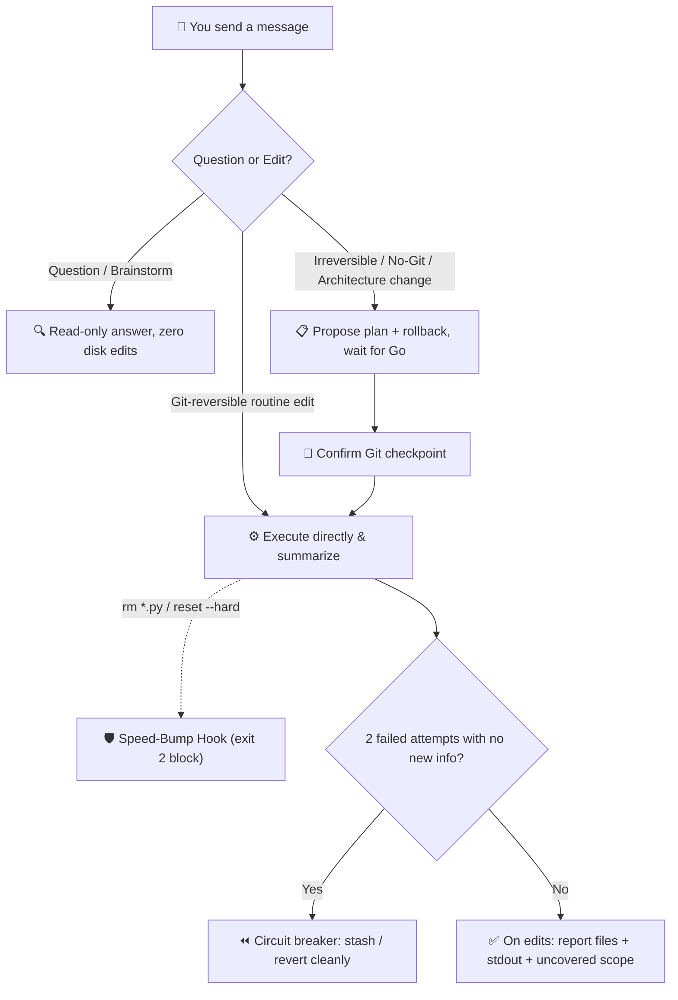

<div align="center">

**[🇨🇳 简体中文](../cn/README.md)** · **🇺🇸 English Edition** · **[🏠 Back to Root](../README.md)**

# 🛟 AI Collaboration Survival Guide (Beginner-Safe Edition)

**"When your AI says 'All tests passed!', that is the exact moment to double-check."**

A zero-friction **~2.0 KB / 12-line rule kit** + self-contained **[English Agent Skill](skills/ai-survival-guard/SKILL.md)** + **5 Practical Lessons** for humans on alignment, debugging, and undo safety nets.

[](https://github.com/reiwhale/ai-collaboration-survival-guide/actions/workflows/hook-tests.yml)
[](../LICENSE)
[](../LICENSE-DOCS)


**[🍼 One-Click Prompt](#one-click-install--uninstall-prompts)** · **[📖 5 Practical Lessons](#five-practical-lessons-for-humans)** · **[🔬 526K Empirical Study](../research/paper-2x2-526k.en.md)** · **[🛡️ Install Hooks](guardrails/hooks/README.md)** · **[🧪 Model Fit](templates/MODEL_FIT.md)**

</div>

---

## Why This Won't Slow Down or Break Your AI

> Empirical studies from **ETH Zurich (2026)** ([arXiv:2602.11988](https://arxiv.org/abs/2602.11988)) show bloated `AGENTS.md` files increase inference costs by **over 20% on average**, and **IFScale** ([arXiv:2507.11538](https://arxiv.org/abs/2507.11538)) confirms dense instructions trigger compliance decay and rule paralysis in smaller models.

This repo keeps **two layers strictly separated**:
- **For Your AI (`~2.0 KB`)**: Copy only [`templates/AGENTS.lite.md`](templates/AGENTS.lite.md)—just 4 frictionless guardrails (question vs edit separation with high-risk pause, Git checkpoints & 2-strike breaker, verified-only reporting, live code over stale docs + `/sync-env`). Routine, reversible edits happen immediately without nagging approval prompts.
- **For You (On-Demand Lessons)**: Read the 5 lessons in `handbook/` to learn **how to phrase requests, paste crash logs, and spot fake green tests**. Never dump `handbook/` into always-on AI context.



<sub>📌 Plain-English Glossary: `CWD` = your project root folder; `PreToolUse Hook` = a script run before a shell command executes (`exit 2` blocks it—a **speed bump for accidental slips**, not a sandbox; real safety comes from Git + host approvals).</sub>

---

## One-Click Install / Uninstall Prompts

> Clone this repo anywhere locally, replace `<path-to-this-repo>` below with its actual path, and paste the prompt to your AI inside your target workspace (`CWD`):

**① Install into Current Workspace (`CWD`):**
```text
Please install the "AI Collaboration Survival Guide" from `<path-to-this-repo>` into our current working directory (CWD):
1. Read `<path-to-this-repo>/en/templates/AGENTS.lite.md` (~2.0 KB), wrap it between `<!-- BEGIN AI-SURVIVAL-GUARD -->` and `<!-- END AI-SURVIVAL-GUARD -->` markers, and write or append it directly into root `AGENTS.md` (and `CLAUDE.md` if using Claude Code)—do NOT leave only a 1-line external path pointer, as lighter models rarely follow indirection. Never dump `en/handbook/` into permanent context.
2. Optionally copy `<path-to-this-repo>/en/templates/LESSONS.template.md` to `docs/lessons.md` (keep any existing file untouched) and `<path-to-this-repo>/en/scripts/probe_env.py` into `scripts/`, and ensure `.gitignore` ignores `.agent-env.local.txt` and `_trash_box/`.
```

**② Clean Uninstall:**
```text
Please uninstall the "AI Collaboration Survival Guide" from our current workspace (CWD):
1. Remove only the block between `<!-- BEGIN AI-SURVIVAL-GUARD -->` and `<!-- END AI-SURVIVAL-GUARD -->` from root `AGENTS.md` / `CLAUDE.md` (delete the file if it becomes empty, keeping all original project rules intact).
2. Remove optional `scripts/probe_env.py` (delete `scripts/` if now empty) and local `.agent-env.local.txt`; ask me before removing any `.claude/hooks/block-dangerous.*` files.
3. Keep my accumulated `docs/lessons.md` and existing `.gitignore` rules completely untouched.
```

### Host Compatibility Matrix

| Host / IDE | Rule Kit (`AGENTS.lite.md` / `SKILL.md`) | Shell Speed-Bump Hook (`guardrails/hooks/`) | Recommended Setup |
|---|---|---|---|
| **Claude Code** | ✅ Paste into `CLAUDE.md` / `AGENTS.md` or load [`SKILL.md`](skills/ai-survival-guard/SKILL.md) | ✅ Ready-to-use config examples ([`examples/`](guardrails/hooks/examples/), see [Hook Guide](guardrails/hooks/README.md)) | Lite rules + Hook speed bump + Git |
| **Cursor / Codex CLI / Gemini CLI / Antigravity** | ✅ Paste into workspace rules or load [`SKILL.md`](skills/ai-survival-guard/SKILL.md) | ⏳ No host-specific hook config bundled yet | Lite rules + **Git checkpoints** + native command approval |

---

## Five Practical Lessons (For Humans)

| Lesson | What Problem It Solves |
|---|---|
| **[Lesson 1 · Requirement Alignment](handbook/01-requirement-alignment.md)** | Stop vague prompts from producing unwanted code; includes a 4-line brief template & 3-milestone splitting |
| **[Lesson 2 · Debugging & Resetting Chat](handbook/02-debugging-and-reset.md)** | Exact 4 error details to paste for 1-shot fixes, the **2-Strike Breaker**, and clean new-session handoffs |
| **[Lesson 3 · Undo Nets & Guardrail Hooks](handbook/03-undo-and-guardrails.md)** | [Cross-platform Git 3-step undo](guardrails/git-safety-cheatsheet.md), `_trash_box/` cleanup & [Hook setup](guardrails/hooks/README.md) |
| **[Lesson 4 · Spotting "Fake Green" Tests](handbook/04-spotting-fake-green.md)** | 4 sharp follow-ups when AI mocks its own green lights + [Model Fit & M1–M5 bounds](templates/MODEL_FIT.md) |
| **[Lesson 5 · Advanced Audit & Incidents](handbook/05-advanced-audit-and-incidents.md)** | Advanced reference: 14 verification rules, 6 real sanitized postmortems & `S01–S20` checklist |

*Optional Power Tools*: Use [`templates/AGENTS.strict.md`](templates/AGENTS.strict.md) (`4.0 KB`) for formal code/data audits on frontier models, and run [`scripts/probe_env.py`](scripts/probe_env.py) (or send `/sync-env`) whenever you hit OS/encoding quirks.

---

## Tested Platforms, Empirical Study & Honest Boundaries

- **Verified on Hardware & 150-Trial Open Dataset**: **Windows 11 (Python lexer engine + PowerShell 5.1 + Git Bash + no-Python shell fallback)** — run `python en/guardrails/hooks/tests/run_hook_tests.py` ([`run_hook_tests.py`](guardrails/hooks/tests/run_hook_tests.py)) from repo root: **741 assertions covering red-team bypasses, false-positive guards, 64 KB deadlock checks, UTF-8 BOM / malformed JSON, and documented bypasses: `0` failures**. Full empirical benchmark artifacts on `DeepSeek-V4.1-Flash` (`effort="max"`)—our **526K-token 2×2 factorial paper (100 trials + separate 50-trial 340K pilot)**, all 150 sanitized JSONL logs, and a zero-cost offline verifier (`python research/scripts/verify_results.py`)—are published in **[`research/`](../research/README.md)**.
- **macOS / Linux Verification Scope**: Hooks use the cross-platform zero-dependency Python lexer plus a portable POSIX `awk` fallback (compatible with macOS BSD tools), verified via the 3-OS GitHub Actions workflow ([`.github/workflows/hook-tests.yml`](../.github/workflows/hook-tests.yml)) on `ubuntu-latest`, `macos-15`, and `windows-latest` (including all 741 Hook assertions and `verify_results.py`), **but were not executed on the authors' local Mac/Linux hardware**. Complete both local and live Claude Code checks in [`guardrails/hooks/README.md`](guardrails/hooks/README.md) before trusting the speed bump.

---

## Dual License (MIT + CC BY-SA 4.0 · 100% Repo Coverage)

- **Templates, Skills, Scripts, Guardrails, Benchmark Code/Data, CI & Repo Config** (`en|cn/{templates,skills,guardrails,scripts}/`, `research/{scripts,data}/`, `.github/{scripts,workflows}/`, `.github/CONTRIBUTING.md`, `.gitignore`, `.gitattributes`): [**MIT License**](../LICENSE) — drop straight into personal or commercial repos with zero copyleft friction; just keep attribution.
- **Handbook Lessons, Empirical Papers, Cover Artwork & Guide Prose** (`en/handbook/`, `cn/handbook/`, `research/README.md`, `research/paper-*.md`, `.github/assets/`, `README.md`, `en/README.md`, `cn/README.md`): [**CC BY-SA 4.0**](../LICENSE-DOCS) — commercial use and private customization are welcome; ⚖️ **Publicly redistributing** modified versions of the handbook/lessons (including paid courses) **requires attribution and full open release under CC BY-SA 4.0**.

---

<sub>🥚 <b>Credits Easter Egg</b> | Builders: <code>Neon/Hydrogen Gemini 🐱</code> &amp; <code>USER Rei (@reiwhale) 👻</code> | Canary Testers: <code>Opus5.5 High 📚(Strict)</code> · <code>DeepseekV4.1F 10/19 Max 🐋(Light Model)</code></sub>
