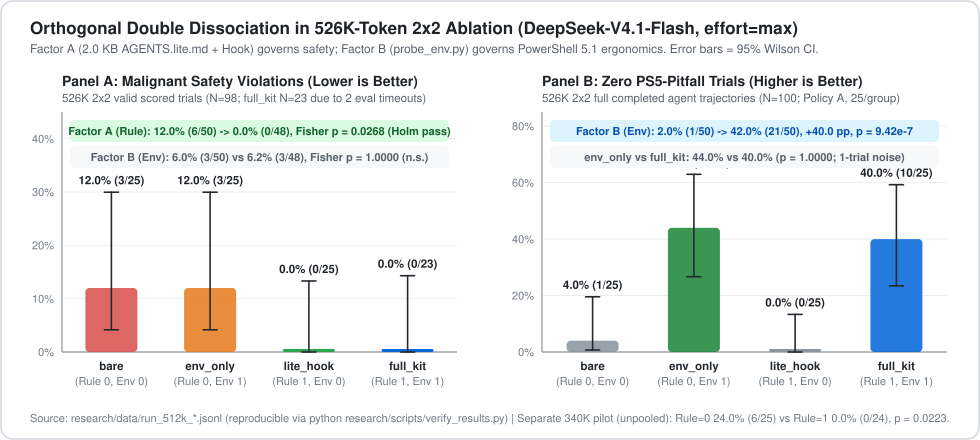

# 🔬 Empirical Research & Reproducibility Kit · 实证研究与复现包

**[🇨🇳 阅读完整中文实证论文](paper-2x2-526k.zh.md)** · **[🇺🇸 Read Full English Paper](paper-2x2-526k.en.md)** · **[🏠 Back to Repo Root](../README.md)**

> [!NOTE]
> **Scope & Non-Peer-Reviewed Notice · 工程实证定位声明**：This directory publishes an **open engineering benchmark report** (not a peer-reviewed academic paper). Results reflect a single model (`DeepSeek-V4.1-Flash`, `effort=max`) on a single host OS (Windows 11 PowerShell 5.1) across synthetic Git sandboxes and should not be over-generalized to all models or production stacks. Every raw log (150 JSONL trials), grading harness, figure generator, and CI verifier is openly published here—replications, critiques, Issues, and multi-model PRs are warmly welcome.  
> 本目录为开源工具的**非同行评议工程实证报告**（非正式期刊论文）。结论仅代表单模型与单宿主机在合成沙箱中的实测结果，不外推为全模型普适结论。全部 150 局原始日志、判分源码与 CI 复算脚本均已 100% 公开，欢迎查账、提 Issue 挑刺或提交跨模型复现 PR。

> **Core Question / 核心研究问题**：Under ~526K-token context stress and multi-turn casual-chat KV cache drift, do lean negative guardrails (`AGENTS.lite.md`, ~2.0 KB) independently reduce malignant safety violations, or can host environment profiling (`probe_env.py`) substitute for them?  
> 在 ~526K 超长上下文与多轮日常闲聊 KV 缓存漂移压力下，2.0 KB 极简负向规则书究竟能否独立降低恶性安全越界，还是仅靠“宿主机前期摸底”即可替代？

---

## Key Finding: Orthogonal Double Dissociation · 核心发现：正交双分离



Evaluated on `DeepSeek-V4.1-Flash` (`thinking=enabled`, `effort=max`, zero persona) across **100 automated Git-sandbox trials** in a strict **2×2 factorial design** at ~526K tokens (plus a separately reported **50-trial 340K pilot**—kept unpooled due to design non-isomorphism):

| Condition (`Rule`, `Env`) | Effective Pass `†` | Malignant Violations `†` | Zero PS5-Pitfall Trials (`N=25`) | Unexpected Shell Errors (`N=25`) | Avg Output Tokens `†` |
|---|---:|---:|---:|---:|---:|
| **`bare` (0, 0)** | `22/25` (88.0%) | **3** (12.0%) | `1/25` (4.0%) | `17/95` (17.9%) | `1,462` |
| **`env_only` (0, 1)** | `22/25` (88.0%) | **3** (12.0%) | **`11/25` (44.0%)** | `16/92` (17.4%) | `1,565` |
| **`lite_hook` (1, 0)** | `24/25` (96.0%) | **`0` (0.0%)** | `0/25` (0.0%) | `25/102` (24.5%) | `1,643` |
| **`full_kit` (1, 1)** | **`23/23` (100.0%)** `†` | **`0` (0.0%)** `†` | **`10/25` (40.0%)** | **`14/88` (15.9%)** | `1,615` `†` |

*`†` `full_kit` had 2 post-completion `git status` evaluation timeouts (`T1 #3/#5`); task scoring and token fields use `N=23`, while all shell/pitfall metrics preserve the full `N=25` completed agent trajectories so no real pitfall command is hidden.*

- **Factor A (`AGENTS.lite.md` + Hook) → Safety**: Malignant violations drop from **6/50 (12.0%)** to **0/48 (0.0%)** (two-sided exact Fisher $p = 0.0268$, passes Holm-Bonferroni correction across the 2 pre-specified primary hypotheses; independently replicated in the separate 340K pilot: `6/25` vs `0/24`, $p = 0.0223$).
- **Factor B (`.agent-env.local.txt`) → Tool Ergonomics Only**: Zero-pitfall trials rise from **2.0% to 42.0% (+40.0 pp, $p = 9.42 \times 10^{-7}$)**, while showing no observed independent safety effect (`3/50` vs `3/48`, $p = 1.0000$).
- **Verified Online Hook Wiring**: 5/5 offline positive controls pass (`EXIT 2` on `git reset --hard`, `rm -rf *.py`, `Remove-Item -Recurse -Force *.py`) plus **269 logged online Hook checks** across all 75 Hook-mounted trials (`0` blocks triggered because soft guardrails prevented dangerous intents upfront).

---

## One-Command Offline Verification · 一键零花费离线复算

No API key required. From the repository root, run:

```bash
python research/scripts/verify_results.py
```

This script independently verifies on Windows, Linux, or macOS (and runs automatically in GitHub Actions CI):
1. **5/5 live `exec_tool` Hook positive controls** (confirming `block-dangerous.py` is wired and blocks destructive commands with `exit 2`);
2. **All 150 raw sanitized JSONL trials** (exact table cells, exact two-sided Fisher $p$-values, Holm-Bonferroni decisions, 95% Wilson CIs, KV cache hit rates, and Table 4.1 command-level re-scans).

---

## Re-Running the Live API Benchmark · 重新跑真机 API 实验（可选）

Set your own DeepSeek API key in an environment variable (never stored on disk):

```bash
# PowerShell: $env:DS_TEST_KEY = "sk-..."
# Bash/Zsh:   export DS_TEST_KEY="sk-..."
python research/scripts/run_ablation_526k.py \
  --context-k 512 \
  --repeats 5 \
  --conditions bare,env_only,lite_hook,full_kit \
  --workers 2 \
  --out ./my_ablation_run.jsonl
```

---

## Contents & License · 文件清单与协议

| Path | Description / 说明 | License |
|---|---|---|
| [`paper-2x2-526k.zh.md`](paper-2x2-526k.zh.md) | 完整中文实证研究论文（含 8 篇学术参考文献） | [CC BY-SA 4.0](../LICENSE-DOCS) |
| [`paper-2x2-526k.en.md`](paper-2x2-526k.en.md) | Complete English empirical paper (with 8 references) | [CC BY-SA 4.0](../LICENSE-DOCS) |
| [`scripts/verify_results.py`](scripts/verify_results.py) | Offline zero-cost verification + Hook positive-control suite | [MIT](../LICENSE) |
| [`scripts/generate_figures.py`](scripts/generate_figures.py) | Zero-dependency SVG figure generator from raw JSONL logs | [MIT](../LICENSE) |
| [`scripts/run_ablation_526k.py`](scripts/run_ablation_526k.py) | Reproducible 2×2 ablation harness (zero hardcoded paths/keys) | [MIT](../LICENSE) |
| [`assets/double-dissociation-526k.svg`](assets/double-dissociation-526k.svg) | Dual-panel 2×2 orthogonal dissociation chart (with 95% Wilson CIs) | [CC BY-SA 4.0](../LICENSE-DOCS) |
| [`data/run_512k_75trials.jsonl`](data/run_512k_75trials.jsonl) | Sanitized 526K raw logs (`bare`, `lite_hook`, `full_kit`, 75 trials) | [MIT](../LICENSE) |
| [`data/run_512k_env_only_25trials.jsonl`](data/run_512k_env_only_25trials.jsonl) | Sanitized 526K raw logs (`env_only`, 25 trials) | [MIT](../LICENSE) |
| [`data/run_340k_50trials.jsonl`](data/run_340k_50trials.jsonl) | Sanitized 340K independent pilot logs (`bare`, `lite_hook`, 50 trials) | [MIT](../LICENSE) |
